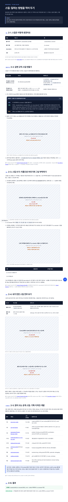
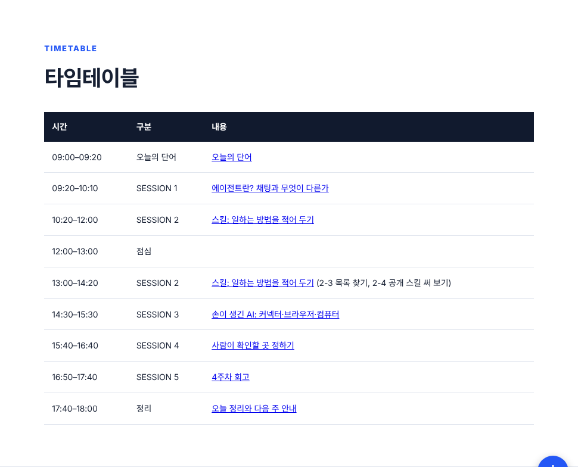
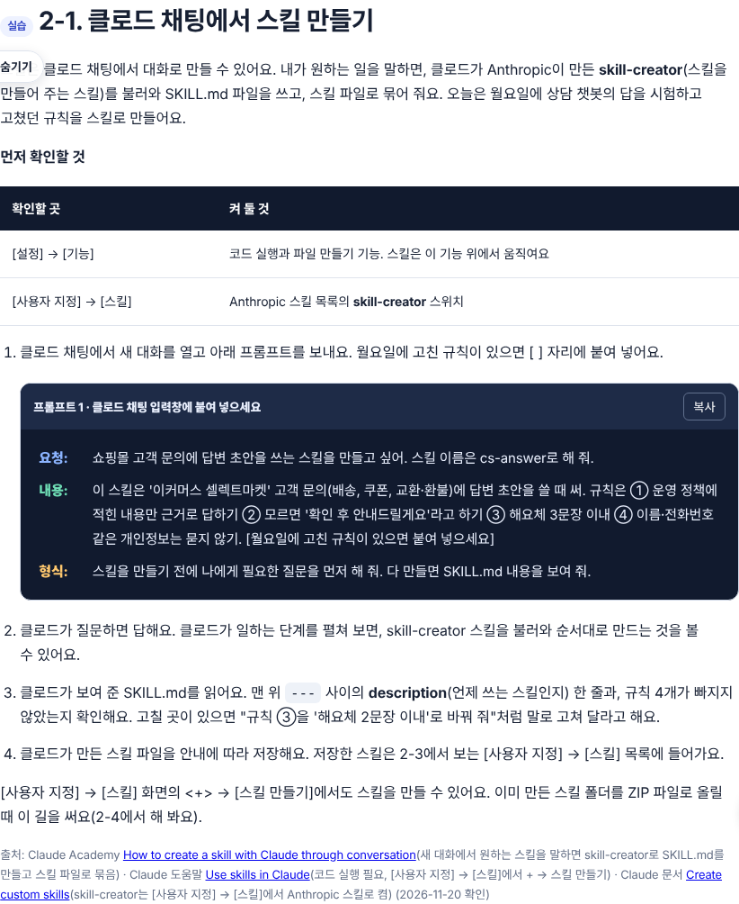
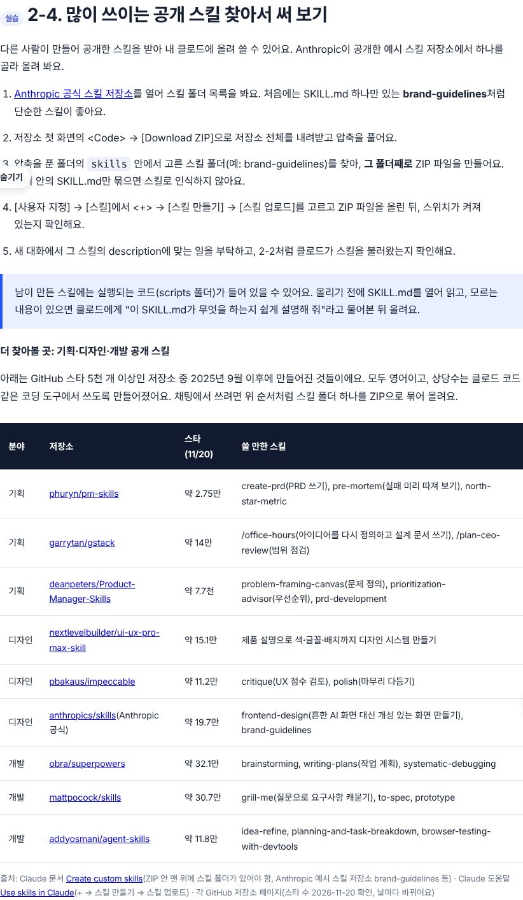

# 4주차 DAY5 · 서브에이전트 전부 삭제, SESSION 2를 클로드 채팅 기준으로 재작성 (261120)

대상: `261116-ai-pm-week4/d5-agent.html`

## 바꾼 것

| 위치 | 전 | 후 |
|---|---|---|
| SESSION 3 서브에이전트 | 개념, 만들기, 맡기기, 결과(캡처 자리 3개 포함) | **전부 삭제** |
| 오늘의 단어 | 서브에이전트 줄 있음 | 삭제 |
| 교육 개요·히어로·결과물·오늘의 규칙·회고 표 | 서브에이전트, '쓰는 역할과 검수하는 역할을 나눈다' | 서브에이전트 관련 문구 삭제, 결과물은 '답변 규칙 스킬 + 공개 스킬 1개 + …' |
| SESSION 2 | `.claude/skills/…` 폴더에 파일을 만드는 클로드 코드(개발자) 방식, 캡처 자리 5개 | 클로드 채팅 기준 **2-1 클로드 채팅에서 스킬 만들기 / 2-2 스킬 써 보기 / 2-3 스킬 목록 찾기 / 2-4 많이 쓰이는 공개 스킬 찾아서 써 보기 / 2-5 결과** |
| 타임테이블 | SESSION 2 10:20–12:00, SESSION 3 13:00–14:20 | SESSION 2를 10:20–14:20(점심 제외) 두 칸으로 |
| SESSION 4·5·6 | — | SESSION 3·4·5로 번호와 절 번호, 본문 속 번호(3-1 표, 4세션, 5-1 회고) 맞춤 |
| 수업 전 준비 | 월요일 폴더 열기 | 월요일에 고친 규칙을 메모장에 모아 두기 |
| 프롬프트 번호 | 1, 4 | 1, 2 |

## 2-1 ~ 2-4 근거 (2026-11-20 KST 확인)

- 대화로 스킬 만들기(새 대화에서 원하는 스킬을 말하면 skill-creator로 SKILL.md를 만들고 스킬 파일로 묶음): academy.claude.com/tutorials/how-to-create-a-skill-with-claude-through-conversation
- 코드 실행 필요, [사용자 지정] → [스킬] 목록·스위치·켠 날짜, + → 스킬 만들기 → 스킬 업로드, 쓰지 않으면 스킬 이름을 넣어 분명히 말하기: support.claude.com/en/articles/12512180-use-skills-in-claude
- skill-creator는 [사용자 지정] → [스킬]에서 Anthropic 스킬로 켬, 클로드가 일한 단계에서 스킬 불러왔는지 확인, ZIP 맨 위에 스킬 폴더가 있어야 함, Anthropic 예시 스킬(brand-guidelines 등): claude.com/docs/skills/how-to
- 공개 스킬 스타 수: 각 GitHub 저장소 페이지

## 확인하지 못한 것

- 대화로 만든 스킬을 저장하는 단추 이름은 공식 문서에 없어서 "안내에 따라 저장"이라고만 적었습니다.
- 한국어 화면의 메뉴 표기([설정] → [기능], [사용자 지정] → [스킬], [스킬 만들기], [스킬 업로드])는 실제 화면으로 다시 확인해야 합니다.
- 실제 화면 캡처는 넣지 않았습니다(빈 캡처 자리도 없음).

## 캡처

전: SESSION 2 / SESSION 3(삭제됨)

후

