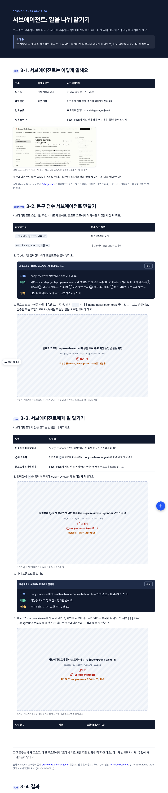
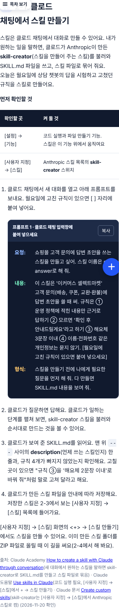
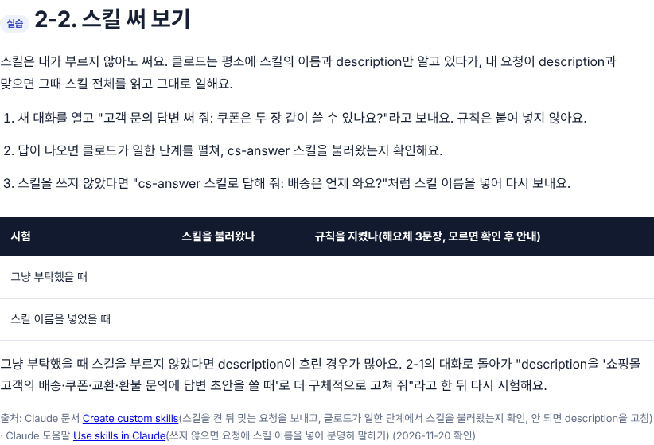
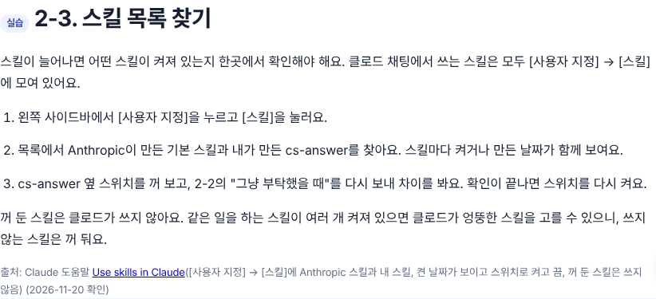
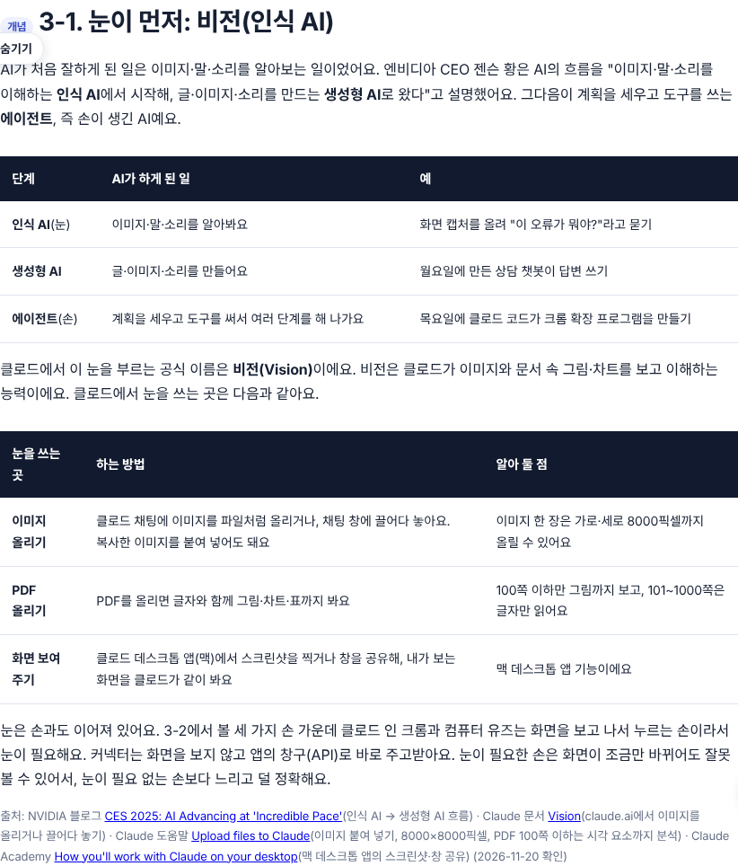
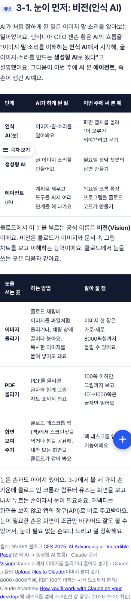
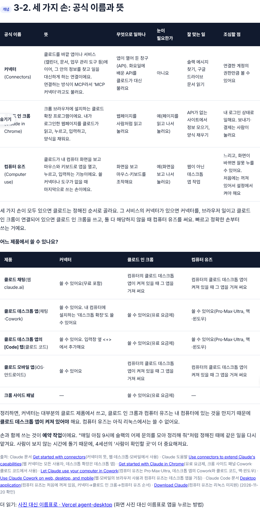
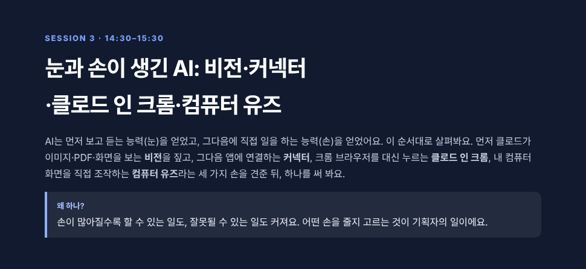

# 4주차 DAY5 · 서브에이전트 전부 삭제, SESSION 2를 클로드 채팅 기준으로 재작성 (261120)

대상: `261116-ai-pm-week4/d5-agent.html`

## 바꾼 것

| 위치 | 전 | 후 |
|---|---|---|
| SESSION 3 서브에이전트 | 개념, 만들기, 맡기기, 결과(캡처 자리 3개 포함) | **전부 삭제** |
| 오늘의 단어 | 서브에이전트 줄 있음 | 삭제 |
| 교육 개요·히어로·결과물·오늘의 규칙·회고 표 | 서브에이전트, '쓰는 역할과 검수하는 역할을 나눈다' | 서브에이전트 관련 문구 삭제, 결과물은 '답변 규칙 스킬 + 공개 스킬 1개 + …' |
| SESSION 2 | `.claude/skills/…` 폴더에 파일을 만드는 클로드 코드(개발자) 방식, 캡처 자리 5개 | 클로드 채팅 기준 **2-1 클로드 채팅에서 스킬 만들기 / 2-2 스킬 써 보기 / 2-3 스킬 목록 찾기 / 2-4 많이 쓰이는 공개 스킬 찾아서 써 보기 / 2-5 결과** |
| 타임테이블 | SESSION 2 10:20–12:00, SESSION 3 13:00–14:20 | SESSION 2를 10:20–14:20(점심 제외) 두 칸으로 |
| SESSION 4·5·6 | — | SESSION 3·4·5로 번호와 절 번호, 본문 속 번호(3-1 표, 4세션, 5-1 회고) 맞춤 |
| 수업 전 준비 | 월요일 폴더 열기 | 월요일에 고친 규칙을 메모장에 모아 두기 |
| 프롬프트 번호 | 1, 4 | 1, 2 |

## 2-1 ~ 2-4 근거 (2026-11-20 KST 확인)

- 대화로 스킬 만들기(새 대화에서 원하는 스킬을 말하면 skill-creator로 SKILL.md를 만들고 스킬 파일로 묶음): academy.claude.com/tutorials/how-to-create-a-skill-with-claude-through-conversation
- 코드 실행 필요, [사용자 지정] → [스킬] 목록·스위치·켠 날짜, + → 스킬 만들기 → 스킬 업로드, 쓰지 않으면 스킬 이름을 넣어 분명히 말하기: support.claude.com/en/articles/12512180-use-skills-in-claude
- skill-creator는 [사용자 지정] → [스킬]에서 Anthropic 스킬로 켬, 클로드가 일한 단계에서 스킬 불러왔는지 확인, ZIP 맨 위에 스킬 폴더가 있어야 함, Anthropic 예시 스킬(brand-guidelines 등): claude.com/docs/skills/how-to
- 공개 스킬 스타 수: 각 GitHub 저장소 페이지

## 확인하지 못한 것

- 대화로 만든 스킬을 저장하는 단추 이름은 공식 문서에 없어서 "안내에 따라 저장"이라고만 적었습니다.
- 한국어 화면의 메뉴 표기([설정] → [기능], [사용자 지정] → [스킬], [스킬 만들기], [스킬 업로드])는 실제 화면으로 다시 확인해야 합니다.
- 실제 화면 캡처는 넣지 않았습니다(빈 캡처 자리도 없음).

## 캡처

전: SESSION 2 / SESSION 3(삭제됨)

후

## 2차 수정 (같은 날): 오늘 수업 흐름 반영, 세 가지 손 공식 이름

### 2-1·2-2를 오늘 수업 기록(슬랙) 흐름으로 다시 씀

| 위치 | 1차 | 2차 |
|---|---|---|
| 2-1 | cs-answer(상담 답변) 스킬을 skill-creator로 만들기 | ① 예전 방식(메타 프롬프팅: "방금 대화의 작업을 하나의 프롬프트로 정리해 줘") ② 목요일 UTM 대화에서 "UTM을 만드는 과정을 다음에 쓸 수 있도록 내장 스킬로 만들어 줘" → [Skill 저장] 카드(이름·설명·[콘텐츠 >]·<닫기>·<저장>) ③ 실습: 내 업무 2가지를 스킬로 ④ 사용 한도 확인 |
| 2-2 | 그냥 부탁하기, 이름 넣어 부탁하기 | 입력창 `/` → "/ 입력하여 필터링" 목록, 이름에 마우스를 올리면 설명, 고른 뒤 주소·채널 이어 쓰기 + 그냥 부탁하기 + (선택) ChatGPT [Chat]과 [Work] 비교(Chat은 ZIP만 내려 줌, Work는 자동 저장, @로 부름) |
| 준비물·결과물 | 상담 챗봇 규칙 | 목요일 UTM 대화, 결과물은 UTM 스킬 + 내 업무 스킬 2개 + 공개 스킬 1개 |

- 근거: 2026-11-20 강사 화면(클로드 [Skill 저장] 카드, / 목록, ChatGPT Chat·Work·스킬 화면). 로린님 결정에 따라 강사가 화면에서 확인한 내용은 확인된 사실로 넣었습니다.
- 수업 기록 반영 규칙에 따라 수강생 결과물과 슬랙 이미지는 넣지 않았고, 강사 예시의 개인 스킬 이름(swy-…)과 설명 속 개인 이름은 일반 이름(utm-link-builder)으로 바꿨습니다.

### SESSION 3 세 가지 손: 공식 이름·뜻·쓸 수 있는 제품

- 제목과 표를 공식 이름으로: 커넥터(Connectors) · 클로드 인 크롬(Claude in Chrome) · 컴퓨터 유즈(Computer use). 오늘의 단어에도 세 용어 정의를 넣음.
- 3-1에 클로드가 손을 고르는 순서(커넥터 → 클로드 인 크롬 → 컴퓨터 유즈)와 제품별 표(클로드 채팅 웹 / 데스크톱 앱 채팅·Cowork / [Code] 탭 / 모바일 앱 / 크롬 사이드 패널)를 추가.
- 근거(2026-11-20 확인): claude.com/docs/connectors/getting-started, support.claude.com 11176164(커넥터), 12012173(클로드 인 크롬), 14128542(컴퓨터 유즈: Pro·Max·Ultra, 데스크톱 앱 Cowork·클로드 코드, 맥·윈도우), 15520349(웹·모바일의 브라우저·컴퓨터 유즈는 데스크톱 앱을 거침), code.claude.com/docs/en/desktop(컴퓨터 유즈 기본 꺼짐, 손 고르는 순서), claude.com/download(리눅스 미지원)

## 3차 수정 (같은 날): 발전 흐름에 맞춰 '눈(비전)' 추가

- SESSION 3 제목: 「눈과 손이 생긴 AI: 비전·커넥터·클로드 인 크롬·컴퓨터 유즈」
- 3-1 새로 추가 「눈이 먼저: 비전(인식 AI)」: 인식 AI → 생성형 AI → 에이전트 흐름 표, 클로드의 공식 이름 비전(Vision), 눈을 쓰는 곳 표(이미지 올리기, PDF 올리기, 맥 데스크톱 앱 스크린샷·창 공유), 눈이 필요한 손과 필요 없는 손의 구분
- 3-2(세 가지 손) 표에 '눈이 필요한가' 열 추가(커넥터 아니요, 클로드 인 크롬·컴퓨터 유즈 예), 실습은 3-3으로
- 오늘의 단어에 비전(Vision) 추가
- 근거(2026-11-20 확인): blogs.nvidia.com/blog/ces-2025-jensen-huang(인식 AI → 생성형 AI), platform.claude.com/docs/en/build-with-claude/vision, support.claude.com 8241126(이미지 붙여 넣기, 8000×8000픽셀, PDF 100쪽 이하 시각 요소 분석), academy.claude.com Claude 101 데스크톱 앱(맥 스크린샷·창 공유)

