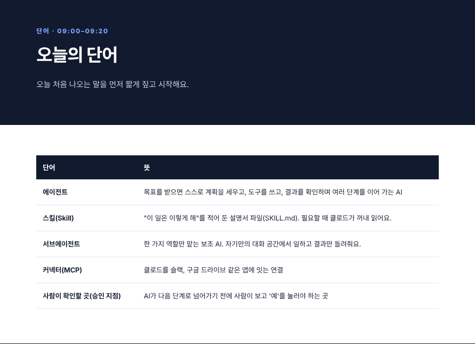
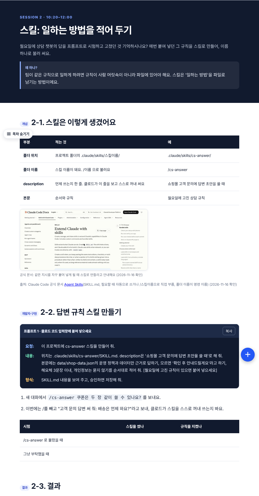
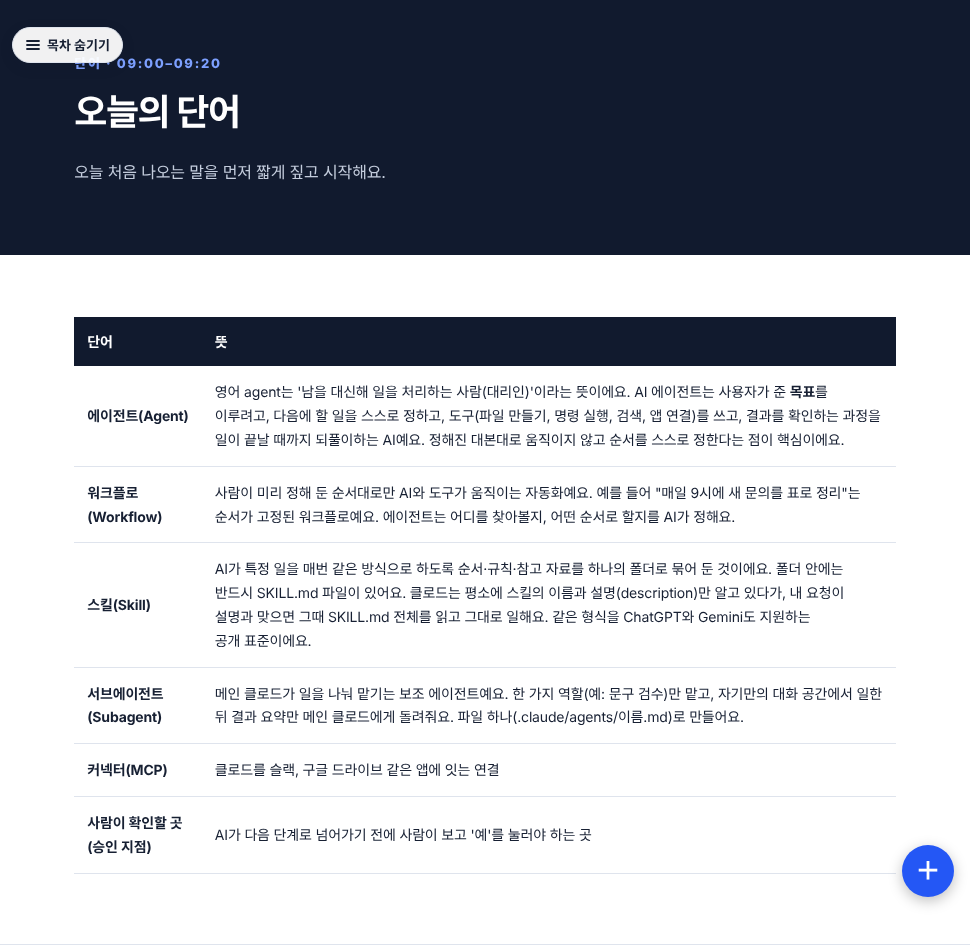
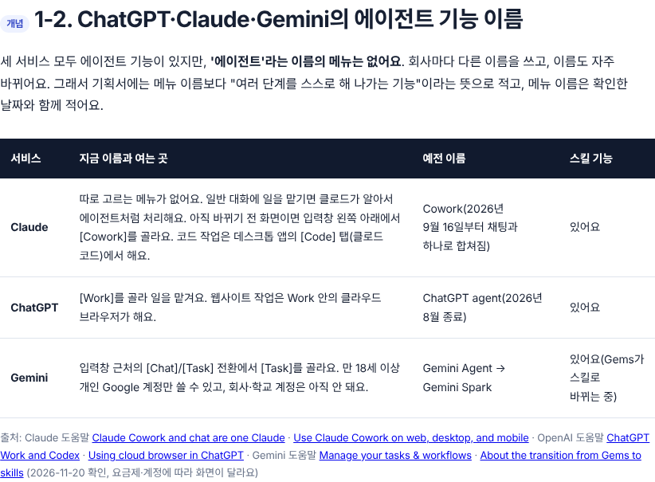
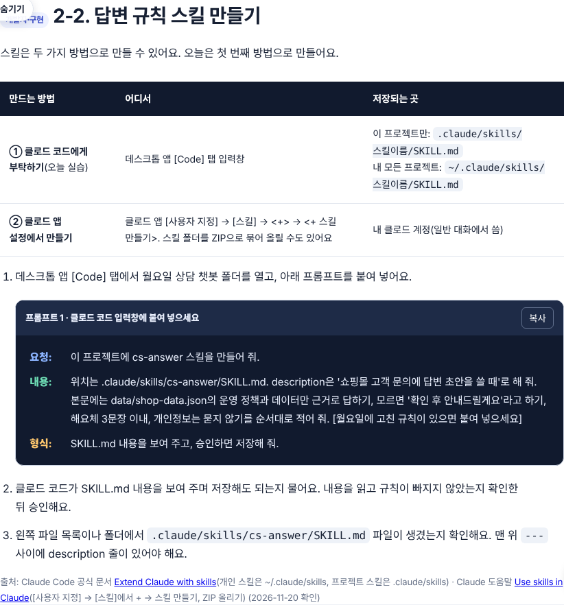
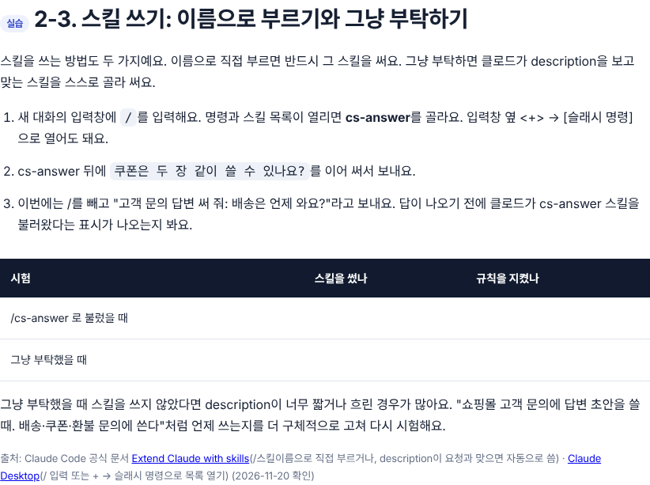
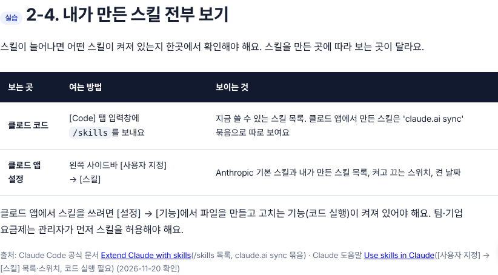
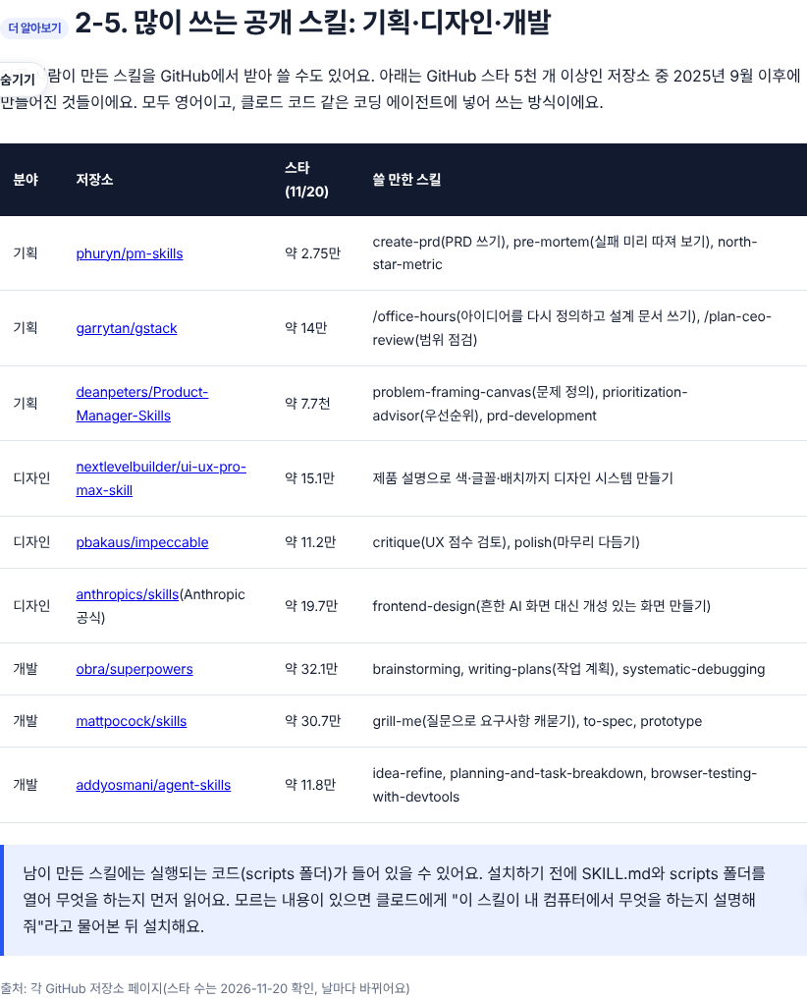
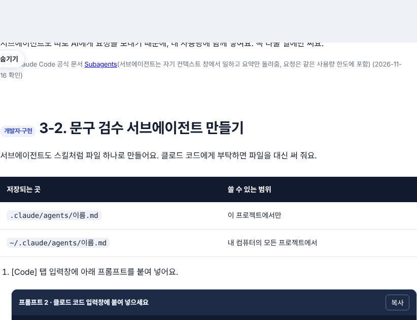
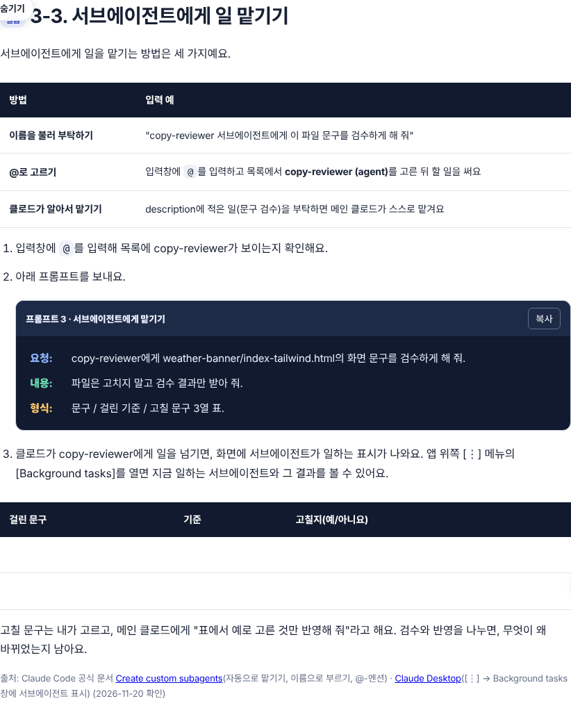

# 4주차 DAY5 · 에이전트·스킬 정의 보강과 만들기·쓰기·전체 보기 추가 (261120)

대상: `261116-ai-pm-week4/d5-agent.html`

## 바꾼 것

| 위치 | 전 | 후 |
|---|---|---|
| 오늘의 단어 | 에이전트·스킬·서브에이전트를 한 줄로만 설명 | 단어 뜻(대리인), 핵심(순서를 스스로 정함), 스킬의 모양(SKILL.md 폴더)과 읽는 시점, 공개 표준을 넣음. **워크플로** 단어를 추가해 에이전트와 구분 |
| 1-1 | 비교 표만 있음 | 에이전트의 네 부분(모델·도구·목표와 규칙·되풀이와 승인)과 공식 출처 추가 |
| 1-2 (새로 추가) | 없음 | ChatGPT·Claude·Gemini의 에이전트 기능 이름 표. 세 서비스 모두 '에이전트'라는 메뉴는 없음 |
| 1-3 | 1-2였던 실습 | 번호만 바뀜 |
| 2-2 | 프롬프트 1개 | 만드는 방법 두 가지 표(클로드 코드 / 클로드 앱 [사용자 지정]→[스킬]), 저장 위치, 저장 승인 단계 |
| 2-3 (새로 추가) | 2-2 안의 두 줄 | 스킬 쓰기: / 목록에서 고르기, 그냥 부탁하기, 스킬을 안 쓸 때 description 고치기 |
| 2-4 (새로 추가) | 없음 | 내가 만든 스킬 전부 보기: [Code] 탭 /skills, 클로드 앱 [사용자 지정]→[스킬](켜기/끄기) |
| 2-5 (새로 추가) | 없음 | 많이 쓰는 공개 스킬 9개(기획·디자인·개발 각 3개, 스타 5천 개 이상, 2025년 9월 이후 만든 저장소)와 설치 전 안전 안내 |
| 3-2 ~ 3-3 | 만들기와 맡기기를 한 절에 둠 | 3-2 만들기(저장 위치 표, 승인 단계) / 3-3 맡기기 세 방법(이름, @, 자동)과 [⋮]→[Background tasks]. 처음에 넣었던 '서브에이전트 전부 보기' 절은 공식 문서에 목록 화면이 없어 삭제함 |
| 사이드 목차 | — | 새 절 반영 |

## 출처와 확인 상태 (2026-11-20 KST 확인)

- 에이전트 정의: anthropic.com/research/trustworthy-agents, anthropic.com/engineering/building-effective-agents
- 스킬 만들기·부르기·/skills·claude.ai sync: code.claude.com/docs/en/skills
- 데스크톱 앱 / 목록, + → 슬래시 명령, [⋮] → Background tasks, Customize: code.claude.com/docs/en/desktop
- 클로드 앱 [사용자 지정]→[스킬], + → 스킬 만들기, ZIP 올리기, 스위치, 코드 실행 필요: support.claude.com/en/articles/12512180-use-skills-in-claude
- 서브에이전트 저장 위치, 맡기는 세 방법: code.claude.com/docs/en/sub-agents (공식 문서에 지금 버전의 서브에이전트 목록·설정 화면이 없어, 목록 보기 절은 넣지 않음)
- 세 서비스 기능 이름: Claude(Cowork와 채팅 통합, 2026-09-16), ChatGPT(agent 종료 → Work), Gemini(Spark → Tasks, 개인 계정·만 18세 이상) — 각 공식 도움말
- 공개 스킬 스타 수: 각 GitHub 저장소 페이지 값

## 화면 캡처

- 처음에는 실제 화면 캡처 자리 8개(shot-todo)를 넣었지만, 캡처하지 못한 상태라 로린님 요청으로 모두 삭제했습니다(3번째 커밋). 본문 설명과 공식 출처는 그대로 둡니다.
- 데스크톱 앱 한국어 메뉴 표기([사용자 지정], [스킬], [슬래시 명령])는 실제 화면으로 다시 확인해야 합니다.

## 캡처

전: 오늘의 단어 / SESSION 2

후

