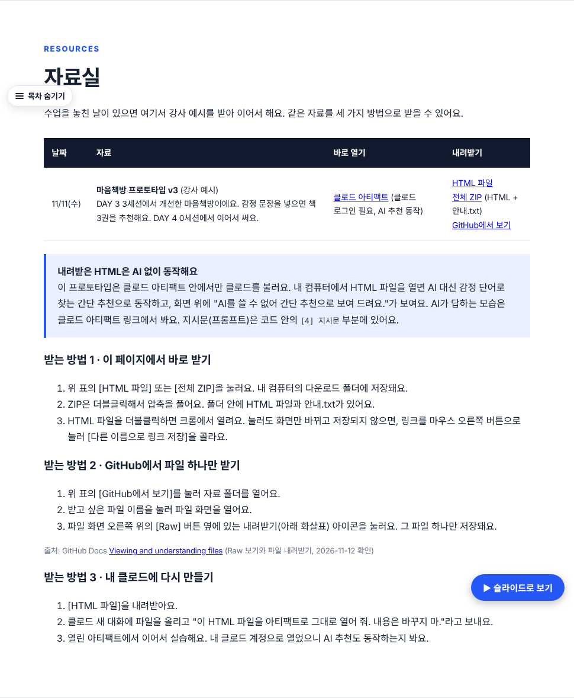
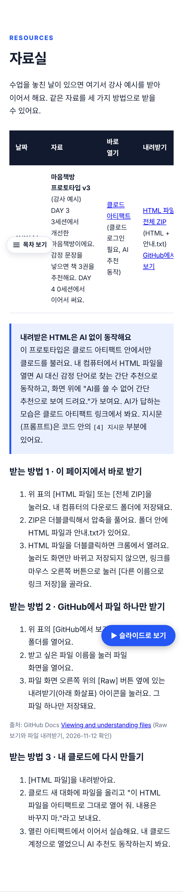
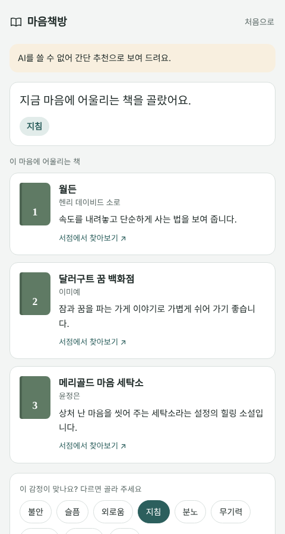

# 3주차 홈 자료실 추가 · 2026-11-12

## 바꾼 것
- 3주차 홈(261109-ai-pm-week3/index.html)에 **자료실** 섹션과 사이드 목차 항목 추가 (이번 주 준비물 앞)
- 자료: 마음책방 프로토타입 v3 (강사 예시, 원본 https://claude.ai/artifact/EmTErvCbmXEEMx1PiAWrRg , 버전 1794377450-5a11)
  - `resources/261111_마음책방_프로토타입_v3.html` (아티팩트 원본 HTML 그대로)
  - `resources/261111_마음책방_프로토타입_v3.zip` (HTML + 안내.txt)
- 받는 방법 3가지: ① 페이지에서 바로 받기 ② GitHub에서 파일 하나만 받기(Raw 옆 내려받기 아이콘, GitHub Docs 근거) ③ 내 클로드에 아티팩트로 다시 열기
- "내려받은 HTML은 AI 없이(간단 추천) 동작" 안내

## 확인한 것
- 내려받은 HTML을 로컬 크롬에서 열고 "오늘은 좀 지쳤어" 입력 → "AI를 쓸 수 없어 간단 추천으로 보여 드려요." + 지침 책 3권 (아래 캡처)
- 1280px·390px 가로 넘침 없음

## 확인하지 못한 것
- 받는 방법 3(클로드에 HTML 올려 아티팩트로 다시 열기)은 실제로 해 보지 않음
- GitHub의 내려받기 아이콘 이름은 문서에 글자로 나오지 않아 "아래 화살표 아이콘"으로 적음

## 캡처
| 화면 | 파일 |
|---|---|
| 자료실 (PC) |  |
| 자료실 (휴대폰 390px) |  |
| 내려받은 HTML 로컬 실행 |  |
